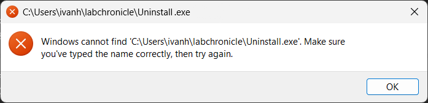

# Troubleshooting an installed app

Problems with an app on your computer, after you installed it. For problems with your repository on GitHub, see [Troubleshooting repository setup](troubleshooting.md).

## App still appears in the Windows Installed apps list after uninstalling

On Windows, it may happen that, after uninstalling the app from `Settings > Apps > Installed apps` as explained in the [uninstalling guide](./download_executable.md), the app still appears in the list and does not allow you to uninstall it again, showing a message like:



The solution is to go to the Control Panel and uninstall it from there. To do this:

1. Open the Control Panel. You can search for it in the Windows search bar.
2. Go to `Programs > Programs and Features`.
3. Find the LabConstrictor-based app in the list, right-click on it, and select `Uninstall`.
4. A message may appear saying something like: "An error occurred while trying to uninstall xxx. It might have already been uninstalled." Click `Yes` to confirm.

This should remove the app even if the previous error message appears.

## Windows asks for administrator rights for python.exe while uninstalling

Uninstalling an app made with template 0.1.20 or earlier may show a User Account Control prompt: "Do you want to allow this app from an unknown publisher to make changes to your device? python.exe", with the program location `"<app folder>\python.exe" -m conda.core.initialize ...`.

The prompt is not needed. Click **No**. The uninstaller then shows a "Failed to clean AutoRun" error with Abort, Retry and Ignore: click **Ignore**. The uninstall finishes normally and nothing outside the app folder is changed. Clicking **Yes** does not help: the same step fails again and shows the same error, and **Retry** asks a second time.

Do not click **Abort**, even though it is the default button: it stops the uninstall halfway and leaves the app folder on disk. If that happened, run `Uninstall-<AppName>.exe` in the app folder again.

The cause is a conda bug in the tool that built the installer (conda/conda#16856). Installers built with template 0.1.21 or later do not have it; see [migration_0_1_21.md](migration_0_1_21.md).

## JupyterLab does not start because Windows reports an ASN.1 certificate error

LabConstrictor-based installers include a TLS-resilient launcher. It attempts
native operating-system certificate verification before JupyterLab imports
Tornado and provides a verified CA-bundle fallback when a malformed Windows
certificate-store entry cannot be parsed. SSL and hostname verification are
never disabled.

The constructor environment intentionally does not include
`pip-system-certs`. Its automatic Python startup hook can fail before the
application launcher has an opportunity to select the verified fallback.
Post-install pip commands instead use an explicit CA bundle while preserving
certificate verification.

Diagnostic information is written to `launcher_debug.log` and
`menuinst_debug.log` in the installation directory. Maintainers can run the
same preflight used by the installer with:

```text
<installation-prefix>\python.exe <installation-prefix>\PROJECT_NAME\launch_jupyter.py --self-test
```

The self-test reports the project-specific CA override variable. It is derived
from the application name by replacing punctuation and spaces with underscores
and converting it to uppercase, for example `MY_PROJECT_CA_BUNDLE`. All
LabConstrictor-based applications also accept the shared
`LABCONSTRICTOR_CA_BUNDLE` variable. Set either variable to an organization PEM
bundle before installation or launch when a private certificate authority is
required.
